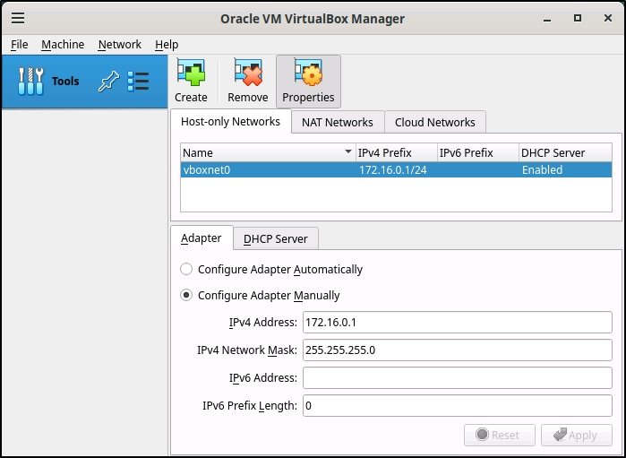

# HashiCorp Packer Builds for Rocky Linux

This is a Packer project to build Rocky Linux 9.6 Vagrant box on VirtualBox using Boot ISO.

## Assumptions

This project assumes no existing installed software (listed below) and everything will be created from scratch.

## Requirements

The following software must be installed on your local machine before you can use Packer to build this Vagrant box:

  - [Packer](http://www.packer.io/)
  - [Vagrant](http://vagrantup.com/)
  - [VirtualBox](https://www.virtualbox.org/)
  - [Rocky Linux](https://rockylinux.org/)

Although not strictly necessary this is a recommended tree structure to get things going:

```bash
├── README.md
└── rocky96
    ├── http
    │   └── ks-rocky96.cfg
    ├── iso
    │   └── Rocky-9.6-x86_64-boot.iso
    ├── output
    │   └── Rocky96.box
    ├── rocky96.pkr.hcl
    └── scripts
        ├── cleanup.sh
        ├── vagrant.sh
        └── virtualbox.sh
```
The Rocky Linux 9.6 Boot ISO (~1.17GB) will be downloaded automatically, or you can pre-download it to the iso/ directory for faster builds. This Boot ISO performs a network installation, downloading packages during the build process.

## VirtualBox homelab setup

For the homelab setup on VirtualBox I recommend that a separate host-only network is setup so you can have a private network of VMs.
You will need to create a new host-only network - vboxnet0 - and create the IP range the network will use such as 172.16.0.0/24.
Also be sure to enable DHCP for the network to make things easy.

<div align="center">
  
</div>

## Post Install Scripts

  - **ks-rocky96.cfg** - This is the kickstart file for the VM build
  - **rocky96.pkr.hcl** - This is the main packer file
  - **cleanup.sh** - Cleanup script after the VM has been created
  - **vagrant.sh** - Setup the vagrant user
  - **virtualbox.sh** - Mount the VBoxGuestAdditions.iso

## Output

Once the packer build is complete the Vagrant box file will be saved to the **output** directory.

## Usage

Make sure all the required software (listed above) is installed, then cd into the **rocky96** directory.

### Option 1: Automatic Build and Add (Recommended)

The easiest way to build and use the box:

**Linux/macOS/WSL:**
```bash
./build-and-add.sh
```

**Windows (Command Prompt/PowerShell):**
```cmd
build-and-add.bat
```

This will automatically:
- Build the Vagrant box using Packer
- Add the box to your local Vagrant installation
- Show you how to use the box

### Option 2: Manual Build Process

If you prefer the manual approach:

```bash
# Build the box
packer build -force -timestamp-ui rocky96.pkr.hcl

# Add the box to Vagrant (the build process now does this automatically)
cd output
vagrant box add Rocky96 Rocky96.box
```

**Note:** The Packer build now automatically adds the box to Vagrant, so the manual `vagrant box add` step is no longer necessary.

## License

MIT

## Author

These configurations are maintained by F.Tao.
